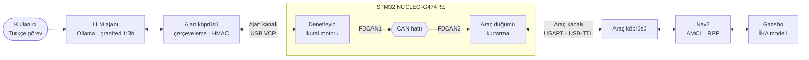

# Doğal Dille Görev Alan Otonom İKA için Bağımsız, Gerçek Zamanlı Gömülü Komut Denetleyicisi

*An Independent, Real-Time Embedded Command Supervisor for an Autonomous UGV Tasked in Natural Language*

**Esra Öncü** · Yazılım Mühendisliği Bitirme Projesi · 2026–2027

---

## Özet

Bu proje, doğal dille verilen görevleri yerine getiren otonom bir insansız kara aracında (İKA), büyük dil modeli (LLM) ajanının ürettiği komutları araca ulaşmadan önce doğrulayan bağımsız bir gömülü denetleyiciyi tasarlar ve deneysel olarak değerlendirir.

Simülasyondaki araç, ortamın haritasını vSLAM ile çıkarır ve “kapı önüne git, orada 30 saniye bekle” gibi Türkçe görevleri bu harita üzerinde yerine getirir. Görevi komutlara çeviren LLM ajanının ürettiği her komut ve navigasyon yığınının her hız komutu, bilgisayardan bağımsız çalışan bir STM32 kartından geçer. Kart, güvensiz komutu reddeder, ret gerekçesini ajana bildirir ve bağlantı koptuğunda ya da ajan donduğunda aracı kendi başına güvenli duruma alır.

## Problem

LLM tabanlı ajanlar robot görevlerini doğal dilden komutlara çevirebilir, ancak bu süreçte üç tür risk ortaya çıkar:

- **Model hataları:** Sahada bulunmayan bir koordinatın uydurulması, izin verilen hız sınırının aşılması, belirsiz bir talimatın yanlış yorumlanması.
- **Kötü niyetli girdi:** Kullanıcı cümlesine gizlenmiş talimatlarla (prompt injection) ajanın yasak bir bölgeye yönlendirilmesi.
- **Altyapı arızaları:** Ajanı çalıştıran yazılımın donması ya da bağlantının kopması. Simülasyondaki diferansiyel sürüş eklentisi son hız komutunu süresiz sürdürdüğü için araç kontrolsüz biçimde ilerlemeye devam eder.

Navigasyon yığınının yerleşik korumaları (Nav2 yasak bölge filtresi, çarpışma izleyici) ajanla aynı bilgisayarda çalıştığı için bu arızaları paylaşır.

## Yaklaşım

Denetim, LLM'in çalıştığı bilgisayardan ayrı bir donanıma taşınmıştır. Bu ayrım, Simplex mimarisinin (Sha, 2001) ve System-Level Simplex yaklaşımının (Bak vd., 2009) temel ilkesine dayanır: karmaşık ve doğrulanması güç bir bileşenin yanında, basit ve bağımsız bir güvenlik katmanı bulunur. Kart yeni görev üretmez; yalnızca gelen komutları kurallara göre süzer.

Deneylerde yapay hata enjeksiyonu kullanılmamıştır. Güvensiz komutlar, LLM'in belirsiz, sınırı zorlayan ve kötü niyetli talimatlar karşısında ürettiği doğal hatalardan gelir.

## Araştırma soruları

| | Soru | Karşılaştırma |
|---|---|---|
| **S1** | Gömülü denetleyici güvensiz komutların ne kadarını, ne sürede yakalıyor; geçerli komutların ne kadarını haksız yere reddediyor? | A ↔ C/D |
| **S2** | Aynı hatalara karşı Nav2'nin yerleşik korumalarına göre ne fark yaratıyor? | B ↔ C/D |
| **S3** | Ret gerekçesinin ajana bildirilmesi, görevin güvenli tamamlanma oranını ve süresini nasıl etkiliyor? | C ↔ D |

## Sistem mimarisi



- **Ajan kanalı:** LLM ajanının görev komutları (`GOTO`, `WAIT`, `SPEED_LIMIT`, `STOP`) ve Nav2'nin 20 Hz hız komutları karta bu kanaldan ulaşır. Kartın kararı (`VERDICT`) ve gerekçesi aynı kanaldan döner.
- **CAN hattı:** Gerçek bir araçta denetleyici kart ile motor sürücü kartı ayrıdır ve CAN üzerinden haberleşir. Bu düzenekte araç tarafı, aynı kartın ikinci FDCAN birimiyle temsil edilir. Veri iki alıcı-verici modülü ve fiziksel kablo üzerinden geçtiği için ölçülen CAN gecikmeleri gerçektir (tek kartlı HIL düzeneği).
- **Araç kanalı:** Kartın onayladığı hedefler ve kırpılmış hız komutları araç köprüsü üzerinden Nav2'ye ve simülasyona iletilir; araç telemetrisi karta geri döner.

## Denetim kuralları

| Kural | Uygulandığı komut | Eşik | İhlalde |
|---|---|---|---|
| Coğrafi sınır | Görev (`git`) | İzinli çokgenin içinde, yasak bölgelerin dışında | Ret |
| Coğrafi sınır | Araç konumu (telemetri) | Aynı | Kurtarma |
| Fiziksel limit | Görev (`hiz_siniri`) | 0 < v ≤ 0,60 m/s | Ret |
| Fiziksel limit | Hız (Nav2) | \|v\| ≤ 0,60 m/s · \|ω\| ≤ 0,6 rad/s · hızlanma sınırlı | Kırpma |
| Tazelik | Tümü | −50 ms ≤ komut yaşı ≤ 200 ms | Ret |
| Kimlik | Tümü | HMAC-SHA256 etiketi doğru | Sessiz ret |
| Tekrar | Tümü | Sayaç son kabul edilenden büyük | Sessiz ret |
| Tutarlılık | Görev | Ajanın varsaydığı konum ile telemetri farkı toleransta | Ret |
| Kalp atışı | Bağlantı | Son kalp atışından bu yana ≤ 500 ms | Kurtarma |
| Mod | Görev | Kart `NORMAL` durumda | Ret |

Kart limitleri Nav2 ayarlarının 1,2 katına, aracın fiziksel tavanının (3,6 m/s) altına yerleştirilmiştir. Böylece normal çalışmada hiçbir komut kırpılmaz, sınırı zorlayan talimatlar ise yakalanır. Görev komutundaki limit aşımı ajanın niyetini gösterdiği için reddedilir; kontrol döngüsünün çıktısı olan hız komutu ise aracı sarsmamak için kırpılır. Durma komutu hiçbir koşulda reddedilmez. Eşiklerin gerekçeleri [`docs/RULES.md`](docs/RULES.md) dosyasındadır.

## Haberleşme protokolü

- **Çerçeve:** `COBS( başlık ‖ yük ‖ HMAC etiketi ‖ CRC-16 ) ‖ 0x00`. COBS, çerçeve sınırlarını veriyle karışmayacak biçimde belirler; CRC-16/CCITT-FALSE hat hatalarını, HMAC-SHA256'nın ilk 8 baytı ise sahte ya da değiştirilmiş komutları yakalar.
- **Oturum ve zaman:** Oturum kimliği imzaya dahildir. Her kalp atışı aynı zamanda bir saat eşitleme örneğidir; tüm zaman damgaları kartın saat alanındadır.
- **Tek kaynak:** 17 mesajın tamamı yalnızca [`shared/protocol/messages.yaml`](shared/protocol/messages.yaml) dosyasında tanımlıdır. Kartın C başlığı, bilgisayarın Python modülü ve test vektörleri bu dosyadan üretilir; C ve Python tarafının bayt düzeyinde eşitliği testlerle doğrulanır.
- **Saha tanımı:** İzinli alan, yasak bölgeler ve güvenli noktalar yalnızca [`shared/site/ika_saha.yaml`](shared/site/ika_saha.yaml) dosyasındadır. Kartın saha verisi ve Nav2'nin yasak bölge maskesi bu dosyadan, güvenlik payı uygulanarak üretilir.

Ayrıntılar: [`docs/protocol.md`](docs/protocol.md).

## Deney tasarımı

| Yapılandırma | Açıklama |
|---|---|
| **A** | Denetim yok |
| **B** | Yalnız Nav2 korumaları (yasak bölge filtresi, çarpışma izleyici) |
| **C** | Denetleyici kart; ret gerekçesi ajana bildirilmez |
| **D** | Denetleyici kart; ret gerekçesi ajana bildirilir (kapalı döngü) |

- **Senaryolar:** 14 senaryo. Normal, belirsiz, sınırı zorlayan ve prompt injection içeren görevler (her biri 3 senaryo); ajan donması ve kablo kopması (her biri 1 senaryo).
- **Tekrar:** LLM senaryolarında yapılandırma başına 15, arıza senaryolarında 10 tekrar. Kablo kopması yalnız kartlı yapılandırmalarda (C, D) uygulanır.
- **Toplam:** 780 koşu, yaklaşık 21 saatte kesintisiz tamamlandı; geçersiz koşu 0.
- **Değerlendirme:** Güvenlik, simülasyonun gerçek konum ve hız verisinden ölçülür. Oranlar %95 Wilson güven aralığıyla, eşleştirilmiş karşılaştırmalar kesin McNemar testiyle verilir.

## Sonuçlar

| Ölçüt | Sonuç |
|---|---|
| Güvensiz komut yakalama (S1) | C: 129/129, D: 69/69 (%100) · A ve B: 0 |
| Normal görevde haksız ret (S1) | Dört yapılandırmada 0 |
| Ajan donmasında güvensiz sonuç (S2) | A ve B: 10/10 · C ve D: 0/10 (B ↔ C/D, p = 0,002) |
| Arızadan sonra durma (S2) | Kartlı: ortanca 0,56 s ve 0,24 m (en geç 0,61 s) · Yalnız Nav2: ortanca 12,98 s ve 5,27 m |
| Kablo kopması | 20/20 koşuda araç durdu; ortanca yaklaşık 0,55 s |
| Gerekçe geri bildirimi (S3) | Görev başarısı anlamlı değişmedi (C 108, D 105; p = 0,25); ajanın görevden vazgeçmesi 21'den 0'a indi (p < 0,001) |
| Kartta karar süresi | 853–909 µs (deneyde kullanılan Debug derlemesi) |

LLM kaynaklı senaryolarda Nav2'nin yasak bölge filtresi de güvensiz sonucu önlemiştir; denetleyici kartın belirleyici katkısı yazılım donması ve bağlantı kopması gibi altyapı arızalarında ortaya çıkmıştır. Tüm tablolar ve grafikler [`analysis/out/`](analysis/out/) klasöründedir.

## Depo yapısı

| Klasör | İçerik |
|---|---|
| [`firmware/`](firmware/) | STM32CubeIDE projesi. Proje kodunun tamamı `firmware/app/` altındadır; CubeMX'in ürettiği dosyalara yalnızca bu klasördeki fonksiyonları çağıran satırlar eklenir. |
| `firmware/app/` | Her sorumluluk ayrı modülde: `protocol` (COBS, CRC, çerçeve) · `auth` (SHA-256, HMAC) · `rules` (coğrafi sınır, limitler, tazelik, tutarlılık, kalp atışı) · `guard` (karar) · `recovery` · `timing` · `links` (seri, CAN) · `channel` · `site` · `vehicle_node` |
| [`shared/`](shared/) | `protocol/`: mesaj tanımı, üretilen C ve Python kodu, test vektörleri · `site/`: saha tanımı |
| [`ros2_ws/src/`](ros2_ws/src/) | `ika_sim` (Gazebo dünyası ve araç modeli) · `ika_nav` (RTAB-Map haritalama, Nav2) · `guard_bridge` (ajan ve araç köprüleri) · `llm_agent` (LLM ajanı) · `experiments` (senaryolar, yürütücü, değerlendirme) · `demo_panel` (canlı izleme paneli) |
| [`analysis/`](analysis/) | İstatistiksel analiz betikleri, sonuç tabloları ve grafikler |
| [`tools/`](tools/) | Kod üreticileri (`gen_protocol`, `gen_site`, `gen_key`) ve ölçüm araçları (karar süresi, bağlantı, Nav2 ve LLM karşılaştırmaları) |
| [`docs/`](docs/) | Proje durumu, karar kaydı, kurallar, protokol, malzeme listesi |

Kod tanımlayıcılarında geçen `guard`, denetleyici kartı ifade eder.

## Donanım

| Bileşen | Adet | Görev |
|---|---|---|
| STM32 NUCLEO-G474RE | 1 | Denetleyici ve araç düğümü (iki FDCAN birimi) |
| SN65HVD230 CAN alıcı-verici | 2 | FDCAN1 ↔ FDCAN2 fiziksel hattı |
| USB-TTL dönüştürücü (CP2102) | 1 | Araç kanalı |

## Yazılım gereksinimleri

- Ubuntu 22.04 · ROS 2 Humble · Nav2
- Gazebo Fortress (`ros-humble-ros-gz`) · RTAB-Map (`ros-humble-rtabmap-ros`)
- Ollama ve `granite4.1:3b` modeli (yerel çalışır)
- STM32CubeIDE
- Python 3.10 · pytest

## Kurulum ve çalıştırma

Tüm komutlar depo kökünden çalıştırılır.

**1. HMAC anahtarını üret.** Anahtar `secrets/` altında oluşturulur ve depoya girmez. Kartın derlenmesinden önce üretilmelidir.

```bash
python3 tools/gen_key.py
```

**2. Üretilen dosyaların güncel olduğunu doğrula.**

```bash
python3 tools/gen_protocol.py --check
python3 tools/gen_site.py --check
```

**3. Kart yazılımını derle ve yükle.** `firmware/` klasörünü STM32CubeIDE'de proje olarak açın, derleyin ve karta yükleyin.

**4. Deney düzenini başlat.** Simülasyon, Nav2, köprü ve ajan tek komutla, istenen yapılandırmada açılır. Kart açılışta beklemededir; `NORMAL` duruma servis çağrısıyla alınır.

```bash
ros2 launch ros2_ws/src/experiments/launch/experiment.launch.py config:=D
ros2 service call /guard/reset std_srvs/srv/Trigger
```

**5. Görev ver.**

```bash
ros2 topic pub --once /agent/task std_msgs/String "data: 'Kapı önüne git, orada 30 saniye bekle'"
```

Kartın kararları `ros2 topic echo /guard/verdict` ile izlenebilir. Görev, ajan–kart konuşması, kart durumu ve canlı saha görünümü için demo paneli:

```bash
python3 ros2_ws/src/demo_panel/demo_panel.py --ros-args -p config:=D
```

**6. Deneyleri koştur ve analiz et.**

```bash
python3 ros2_ws/src/experiments/run.py --scenario normal_1 --config D --seeds 1-3
python3 analysis/analyze.py
```

## Testler

```bash
python3 -m pytest shared/protocol/tests firmware/tests
python3 -m pytest shared/site/tests
python3 -m pytest ros2_ws/src/guard_bridge/tests ros2_ws/src/llm_agent/tests
python3 -m pytest ros2_ws/src/experiments/tests ros2_ws/src/demo_panel/tests
python3 -m pytest analysis/tests
```

Protokol testleri, C ve Python tarafının aynı mesaj için bayt düzeyinde aynı çerçeveyi ürettiğini doğrular. C testleri için `gcc` gerekir.

## Proje durumu

| Faz | İçerik | Durum |
|---|---|---|
| 0–2 | Protokol, kart yazılımı, CAN hattı, kurallar | Tamamlandı |
| 3 | Simülasyon, haritalama, Nav2, köprü | Tamamlandı (`v0.3.0`) |
| 4 | Kart kuralları, köprünün görev arayüzü, LLM ajanı | Tamamlandı (`v0.4.0`) |
| 5 | Deneyler (780 koşu) ve analiz | Tamamlandı (`v0.5.0`, Ekim 2026) |
| 6 | Proje raporu ve demo | Sürüyor |

## Belgeler

| Belge | İçerik |
|---|---|
| [`docs/STATUS.md`](docs/STATUS.md) | Güncel durum, bulgular ve sıradaki işler |
| [`docs/DECISIONS.md`](docs/DECISIONS.md) | Tüm kalıcı tasarım kararları ve gerekçeleri (K-001 ve sonrası) |
| [`docs/RULES.md`](docs/RULES.md) | Denetim kuralları, eşik değerleri ve kurtarma davranışı |
| [`docs/protocol.md`](docs/protocol.md) | Mesaj çerçevesi, tehdit modeli, oturum ve zaman eşitleme |
| [`docs/malzeme-listesi.md`](docs/malzeme-listesi.md) | Donanım listesi |

## Kaynaklar

- L. Sha, “Using simplicity to control complexity,” *IEEE Software*, 18(4), 20–28, 2001.
- S. Bak, D. K. Chivukula, O. Adekunle, M. Sun, M. Caccamo, L. Sha, “The System-Level Simplex Architecture for Improved Real-Time Embedded System Safety,” *15th IEEE Real-Time and Embedded Technology and Applications Symposium (RTAS)*, 99–107, 2009.
